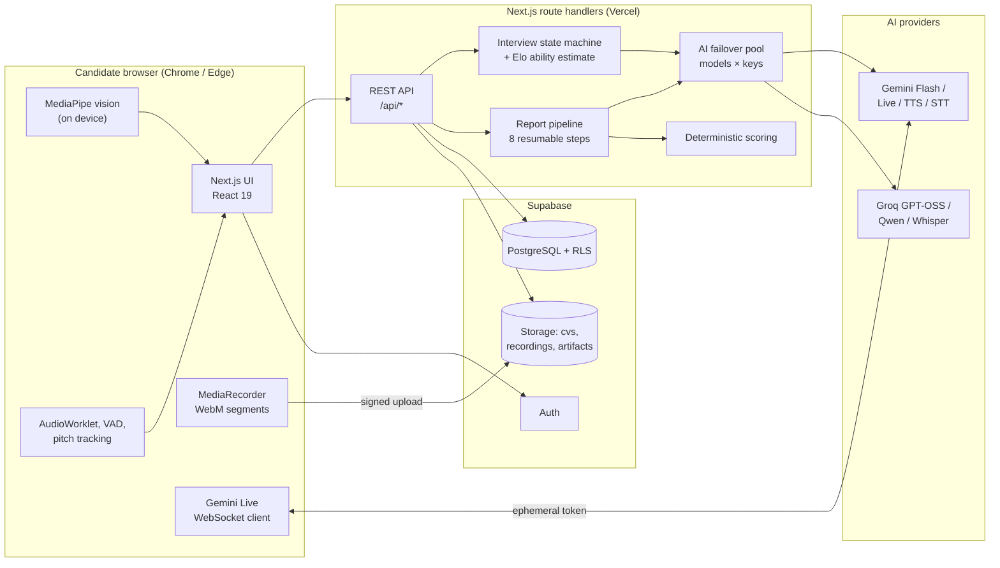

# SkillMirror

**SkillMirror is an AI job-interview simulator and structured hiring platform.** A candidate uploads a CV, picks a role and company, and is interviewed out loud, on camera, by an AI interviewer that adapts its questions to every answer. Afterwards they get an evidence-backed report with scores, video clips of key moments and practice drills. Hiring teams use the same engine to run consistent first-round interviews and compare candidates side by side.

Built with Next.js 16, React 19, Supabase, Drizzle ORM, MediaPipe, Google Gemini and Groq.

---

## For judges: the 3 minute 30 second path

The fastest way to see the whole product is the **3 min 30 s** interview. In the length picker it is highlighted in yellow and marked **Recommended for judges**.

1. Sign up, then on **Interview Studio** either upload a PDF CV or choose **Use sample CV in Judge mode**. Judge mode also fills in sample job details you can edit.
2. Pick **3 min 30 s** (Judge mode selects it for you) and start.
3. Run the camera and microphone setup, answer the AI interviewer, and open the report when processing finishes.

The 3 min 30 s length always runs on the **fast AI path**:

| Stage | What the fast path does |
| :--- | :--- |
| Interview preparation | The interview plan and per-skill question ladders use low model reasoning, so preparation finishes in seconds rather than tens of seconds. |
| Live interview | The live interviewer runs with low thinking for quicker replies. Phase budgets are fixed: 25 s intro, 50 s behavioral, 115 s technical, 20 s close. |
| Report | The written coaching summary uses low reasoning. Tone analysis, rescoring and transcription run under bounded timeouts (see [Performance](#performance-and-reliability)). |

---

## The problem

- **Interview practice does not resemble a real interview.** Question banks and text chatbots do not listen to a spoken answer, ask a follow-up when an answer is vague, or raise and lower difficulty. Candidates rehearse answers but never practise the conversation.
- **Feedback is vague and unverifiable.** "Be more confident" does not tell a candidate *which* answer was weak or *when* they lost eye contact. Human mock interviews are expensive, inconsistent and rarely recorded.
- **First-round hiring interviews do not scale.** Every interviewer asks different questions and scores differently, so candidates cannot be compared fairly. Screening hundreds of applicants takes hundreds of interviewer hours.

## Our solution

One adaptive interview engine with two workflows:

- **Practice mode.** Choose a role, company and level, upload a CV, and take a timed voice-and-video interview (2 min, 3 min 30 s, 10 min or 20 min). The interviewer asks questions grounded in the CV and the job, follows up on vague answers, and moves up or down a five-level difficulty ladder per skill. The private report links every comment to the exact video moment and ends with practice drills. A signed certificate can be shared publicly.
- **Hiring mode.** A company creates an opening with its own must-ask questions (typed, generated, or imported from PDF/DOCX), invites candidates by link or CSV, and receives structured, comparable scorecards. Feedback visibility to candidates is configurable, and AI follow-up questions are marked separately from company questions.

## Why it is feasible

- **It already runs end to end.** Practice and hiring flows work in the browser today, with a production build, 183 automated unit and API tests, and Playwright browser flows.
- **No special hardware or installs.** Everything runs in desktop Chrome or Edge with a normal webcam and microphone. Body-language analysis runs on the candidate's own device.
- **Low and predictable cost.** Vision and voice measurements run locally, so the cloud models only receive text, a CV PDF and one audio file per interview. Any number of Gemini and Groq API keys can be pooled, and the app falls back across models automatically.
- **It degrades gracefully instead of failing.** If every AI provider is down, interview preparation falls back to role-based questions, and the report falls back to the live transcript and deterministic scores. A full **mock mode** runs the entire product with no external services at all.
- **Production basics are in place.** Supabase Auth, PostgreSQL row-level security, signed short-lived media URLs, daily usage quotas, scheduled recording retention, and HMAC-signed certificates.

---

## This is not a chatbot wrapped around an API

A chatbot sends the user's text to a model and shows the reply. In SkillMirror the language models are components inside a larger system. The interview flow, scoring, measurement and evidence all live in our own code. You can check each point in the repository:

| Claim | Evidence in the code |
| :--- | :--- |
| **The interview is controlled by a state machine, not by the model.** The model scores an answer against a rubric; deterministic code decides whether to follow up, clarify, step difficulty up or down, change phase, or wrap up, and enforces time budgets. | [`src/lib/strategist/engine.ts`](src/lib/strategist/engine.ts) (`transition`, `selectNext`, `phaseLimits`) |
| **Adaptive difficulty uses an ability estimate.** Each skill keeps a running ability score (theta) updated with an Elo-style rule after every scored answer, which picks the next question level from L1 to L5. | [`src/lib/strategist/elo.ts`](src/lib/strategist/elo.ts), [`staircase.ts`](src/lib/strategist/staircase.ts) |
| **Model output is validated, not trusted.** Every structured response is parsed with a Zod schema and checked against rubric rules. Invalid output is retried once with the failing fields named, then rejected. | [`src/lib/ai/schemas`](src/lib/ai/schemas), [`structured-output.ts`](src/lib/ai/structured-output.ts), [`strategist/scoring.ts`](src/lib/strategist/scoring.ts) |
| **Body language is measured on the device, with no AI API.** MediaPipe face, pose and hand landmarks run in the browser (WebGL2, CPU fallback) to measure eye contact against a calibrated gaze baseline, posture, fidgeting, self-touch, arms crossed and multiple faces. | [`src/lib/vision/features.ts`](src/lib/vision/features.ts), [`engine.ts`](src/lib/vision/engine.ts), [`aggregator.ts`](src/lib/vision/aggregator.ts) |
| **Voice is measured with signal processing.** Pitch tracking, voice activity detection, speaking pace, response latency, long pauses, filler words, hedges and uptalk are computed from audio and timestamps. | [`src/lib/report/voiceMetrics.ts`](src/lib/report/voiceMetrics.ts), [`src/lib/audio`](src/lib/audio) |
| **Scores come from formulas, not opinions.** Component weights, soft-skill dimensions, integrity badges, verdicts and certificate eligibility are calculated deterministically and checked against a hand-calculated golden fixture. | [`src/lib/report/scoring.ts`](src/lib/report/scoring.ts), [`tests/fixtures/session-01`](tests/fixtures/session-01) |
| **Evidence is time-aligned.** Whisper word timestamps are aligned to each answer window so every key moment in the report links to a playable video clip. | [`src/lib/report/align.ts`](src/lib/report/align.ts), [`keyMoments.ts`](src/lib/report/keyMoments.ts) |
| **It works with the models switched off.** `NEXT_PUBLIC_AI_MODE=mock` runs the whole product, including interviews, scoring and reports, without calling any AI provider. | [`src/lib/ai/mock`](src/lib/ai/mock) |

The models are used for what they are good at: reading a CV, writing questions, judging an answer against a rubric, speaking, transcribing and writing coaching text. Everything else is application logic.

---

## APIs and services used

| Service | API / model | Used for |
| :--- | :--- | :--- |
| **Google Gemini** | Interactions API (`v1beta`): `MODEL_FLASH` ladder `gemini-4-hydrogen` → `gemini-3.8-flash` → `gemini-3.7-flash` → `gemini-3-flash-preview` → `gemini-3.5-flash-lite` | CV parsing (PDF input), interview blueprint and question ladders, answer evaluation fallback and post-interview rescoring, tone analysis (audio input), report narrative, question generation and import |
| **Google Gemini Live** | Live API (`v1alpha` ephemeral tokens): `gemini-3.8-live-extended-thinking` → `gemini-3.8-live` | The real-time spoken interviewer, with non-blocking `next_step` and `flag_observation` tool calls |
| **Google Gemini speech** | `gemini-3.5-transcribe-live`, `gemini-3.5-transcribe`, TTS `gemini-3.8-flash-tts` → `gemini-3.8-flash-lite-tts` | Live captions, batch transcription fallback, interviewer voice in pipeline mode |
| **Groq** | Chat completions (JSON mode): `openai/gpt-oss-120b` → `qwen/qwen3.8-27b` → `openai/gpt-oss-20b` | Low-latency live answer scoring (strategist), interview preparation alongside Gemini |
| **Groq Whisper** | `whisper-large-v3-turbo` → `whisper-large-v3` | Word-level timestamped transcription of the recording |
| **Supabase** | Auth, PostgreSQL, Storage | Accounts (email and Google OAuth), data with row-level security, CVs, recordings and artifacts |
| **GitHub REST API** | `api.github.com/repos` (optional) | Enriching public repositories linked in a CV |
| **Gmail SMTP** | Nodemailer with an App Password | Candidate invitation emails |
| **MediaPipe Tasks Vision** | Runs in the browser, not an API | Face, pose and hand landmarks for body-language analysis |
| **Vercel** | Hosting and Cron | Deployment and daily recording retention cleanup |

---

## Architecture



### Request flow for one interview

1. **CV upload.** The browser asks for a signed upload URL (`POST /api/cv/upload-url`) and uploads the PDF straight to Supabase Storage. `POST /api/cv/[id]/parse` validates the PDF (type, size, 1–10 pages) and sends it to Gemini, which returns a structured profile validated with Zod. Only one read runs per CV: a second request waits for the first instead of calling the model again.
2. **Preparation.** `POST /api/sessions/[id]/plan` takes a lease on the session and builds a blueprint (competencies, behavioral and CV questions) and a five-level question ladder per competency, under a 50 s deadline. Gemini and Groq models are tried in ranked order, and role-based questions are used if every provider fails.
3. **Setup.** The setup wizard checks the browser, camera, microphone, framing, lighting, posture and gaze baselines, room noise and echo, and records consent.
4. **Live interview.** The browser opens a Gemini Live WebSocket with an ephemeral token whose configuration is locked on the server. After each answer, `POST /api/sessions/[id]/strategist` scores it (Groq first, Gemini fallback) and the state machine returns the next directive. Vision and voice metrics stream alongside, and recording segments upload in the background.
5. **Report pipeline.** `POST /api/sessions/[id]/process` runs eight steps: `verify_media`, `transcribe` (Whisper), `align`, `rescore`, `tone` (Gemini audio), `score`, `narrate` and `finalize`. Each finished step is saved, so a run can be resumed. If a run approaches the server time limit, it saves its progress and hands back to the browser, which continues immediately.
6. **Report.** The report shows scores, per-skill ability, delivery metrics, and key moments linked to video clips with an optional skeleton overlay. Practice reports can issue a signed certificate verified at `/verify/[slug]`.

### AI failover pool

[`src/lib/ai/pool.ts`](src/lib/ai/pool.ts) accepts any number of keys per provider and tries **the best model across every key first**, then steps down the model ladder.

- A rate limit, server error, missing model or bad key puts only that `(key, model)` pair in a cooldown and moves on.
- A model that times out is slow on every key, so the pool moves to the next model instead of waiting on the same model again. The last model in a chain shares its time across keys so one stuck key cannot use it all.
- A request rejected as invalid is tried once on each remaining model. A request rejected for its size is not re-sent.
- Every call logs its provider, model, key slot and `durationMs`.
- `/admin` (email allowlist) shows key slots (masked), model ladders and live cooldowns.

---

## Performance and reliability

| Area | Limit or behaviour |
| :--- | :--- |
| CV parsing | Route limit 120 s, model budget 100 s. A slow provider ends in a retryable "failed" state rather than a platform timeout. Concurrent reads of the same CV are merged into one model call. |
| Storage reads | A missing file returns "upload first"; a transient Storage error is retried once and then reported. A missing bucket is reported as a server error. |
| Interview preparation | 50 s total deadline (38 s for the blueprint). Low reasoning on the 3 min 30 s path. |
| Live scoring | Groq 3.5 s, Gemini fallback 4 s, so the conversation never waits on a slow model. |
| Post-interview rescoring | 20 s per answer, run in batches of four. |
| Tone analysis | 45 s per recording, all recordings in parallel. |
| Report run | A new step only starts during the first 180 s of a request (route limit 300 s), so a run never stalls behind a 290 s lease. |

---

## Interview lengths

| Workflow | Lengths |
| :--- | :--- |
| Practice | 2 min (quick test), **3 min 30 s (recommended for judges)**, 10 min, 20 min |
| Hiring openings | 2 min (test), **3 min 30 s (recommended for judges)**, 15, 20, 30, 45 min |

**Judge mode** is available on the practice CV step, in the practice job details, and in a hiring opening's **Settings → Preview interview** dialog. It fills empty fields with editable sample details, fixes the length at 3 min 30 s, and labels the report as a demonstration.

The interface uses a dark theme only.

---

## Tech stack

| Layer | Technologies |
| :--- | :--- |
| **Framework** | Next.js 16 (App Router, Turbopack), React 19, TypeScript |
| **UI** | CSS design system (dark theme), Tailwind CSS v4, Radix UI, Framer Motion, Recharts, Lucide icons, Sonner |
| **Auth & data** | Supabase Auth (email and Google OAuth), PostgreSQL with row-level security (migrations `0000`–`0008`), Drizzle ORM, Supabase Storage |
| **AI** | `@google/genai` (Interactions API, Live API, TTS, transcription), `groq-sdk` (JSON mode, Whisper timestamps) |
| **In-browser media** | `@mediapipe/tasks-vision`, `@ricky0123/vad-web`, Web Audio `AudioWorklet`, `pitchy`, `MediaRecorder` |
| **Documents** | `pdf-lib`, `mammoth` |
| **Testing** | Vitest (with PGlite for database and RLS tests), Playwright, ESLint 9 |

---

## Getting started

### Prerequisites

- Node.js 24.x
- Desktop Chrome or Edge 120+ with a webcam and microphone

### Option A: local mock mode (no external services)

Runs the full product offline, storing data in `.skill-mirror/`.

1. Install dependencies:
   ```bash
   npm ci
   ```
2. Create `.env.local`:
   ```env
   NEXT_PUBLIC_APP_URL=http://localhost:3000
   NEXT_PUBLIC_AI_MODE=mock
   ```
3. Start the dev server:
   ```bash
   npm run dev
   ```
4. Open [http://localhost:3000](http://localhost:3000) and sign up. Sign-ups are confirmed immediately in mock mode.

### Option B: full setup (Supabase + Gemini + Groq)

1. Install dependencies with `npm ci`.
2. Copy `.env.example` to `.env.local` and fill in your credentials.
3. Create a Supabase project and apply every migration in `supabase/migrations/` (`0000_lean_rhodey.sql` through `0008_docs_module.sql`) with the Supabase CLI or `npx drizzle-kit migrate`.
4. In Supabase Auth, enable email sign-up (templates are in `supabase/email-templates/`), optionally Google OAuth, and add redirect URLs for `/auth/callback` and `/auth/confirm` on both localhost and your deployment.
5. Add one or more AI keys. There is no upper limit:
   ```env
   GEMINI_API_KEY=AIza...key1,AIza...key2
   GROQ_API_KEY=gsk_...key1,gsk_...key2
   # Also merged in order: GEMINI_API_KEYS, GEMINI_API_KEY_1..N, GROQ_API_KEYS, GROQ_API_KEY_1..N
   ```
6. Run `npm run dev`, or `npm run build` then `npm run start`.

---

## Environment variables

| Variable | Default / example | Description |
| :--- | :--- | :--- |
| `NEXT_PUBLIC_APP_URL` | `http://localhost:3000` | Public base URL for redirects and verification links |
| `NEXT_PUBLIC_AI_MODE` | `live` \| `pipeline` \| `mock` | `live` uses the Gemini Live WebSocket; `pipeline` uses chunked Whisper and TTS; `mock` runs offline |
| `NEXT_PUBLIC_AI_DATA_TIER` | `unpaid` \| `paid` | `unpaid` asks users to confirm they are using fictional material |
| `NEXT_PUBLIC_SUPABASE_URL` / `NEXT_PUBLIC_SUPABASE_ANON_KEY` | — | Supabase project URL and public key |
| `SUPABASE_SERVICE_ROLE_KEY` | — | Supabase service-role key (server only) |
| `DATABASE_URL` | — | PostgreSQL connection string for Drizzle and migrations |
| `GEMINI_API_KEY` (+ `GEMINI_API_KEYS`, `GEMINI_API_KEY_1..N`) | — | One or more Gemini keys |
| `GROQ_API_KEY` (+ `GROQ_API_KEYS`, `GROQ_API_KEY_1..N`) | — | One or more Groq keys |
| `MODEL_FLASH` / `MODEL_FLASH_FALLBACKS` | `gemini-4-hydrogen` / `gemini-3.8-flash,…` | Gemini reasoning model and fallback ladder |
| `MODEL_LIVE` / `MODEL_LIVE_FALLBACKS` | `gemini-3.8-live-extended-thinking` / `gemini-3.8-live` | Real-time interviewer model and fallback |
| `MODEL_LIVE_THINKING_LEVEL` | `low` \| `medium` \| `high` | Live thinking depth (the 3 min 30 s path always uses `low`) |
| `MODEL_TRANSCRIBE` / `MODEL_TRANSCRIBE_LIVE` | `gemini-3.5-transcribe` / `gemini-3.5-transcribe-live` | Batch and live transcription models |
| `MODEL_TTS` / `MODEL_TTS_FALLBACKS` | `gemini-3.8-flash-tts` / `gemini-3.8-flash-lite-tts` | Interviewer voice models |
| `GROQ_STRATEGIST_MODEL` / `GROQ_STRATEGIST_FALLBACKS` | `openai/gpt-oss-120b` / `qwen/qwen3.8-27b,openai/gpt-oss-20b` | Live answer scoring models |
| `GROQ_WHISPER_MODEL` / `GROQ_WHISPER_FALLBACKS` | `whisper-large-v3-turbo` / `whisper-large-v3` | Recording transcription models |
| `MAX_INTERVIEWS_PER_DAY` | `50` | Daily practice interviews per user |
| `MAX_COMPANY_INTERVIEWS_PER_DAY_PER_ORG` | `200` | Daily invitation acceptances per organization |
| `RECORDING_RETENTION_DAYS` | `30` | Days before recordings are deleted |
| `ADMIN_EMAILS` | — | Emails allowed to open `/admin` |
| `CERT_SIGNING_SECRET` | 32+ bytes hex | HMAC secret for certificates |
| `CRON_SECRET` | 32+ bytes hex | Bearer secret for `/api/cron/retention` |
| `GMAIL_USER` / `GMAIL_APP_PASSWORD` | — | Sender for invitation emails ([App Passwords](https://support.google.com/accounts/answer/185833)) |
| `FEATURE_GITHUB` / `GITHUB_TOKEN` | `false` | Optional GitHub enrichment of CV projects |

---

## Scripts and testing

```bash
npm run dev            # Development server (Turbopack)
npm run build          # Production build
npm run start          # Serve the production build
npm run lint           # ESLint, zero warnings allowed
npm run typecheck      # Route type generation + TypeScript
npm test               # Vitest: unit, failover pool, API regression and RLS suites
npm run test:e2e       # Playwright browser flows in mock mode on port 3001
npm run audio:previews # Regenerate the Kore / Charon voice previews with Gemini TTS
```

---

## Deployment (Vercel)

- Set every server and public variable in Vercel, with `NEXT_PUBLIC_APP_URL` matching the production domain.
- Recording retention runs daily at 03:00 UTC through [`vercel.json`](vercel.json) (`/api/cron/retention`, authenticated with `CRON_SECRET`).
- With `NEXT_PUBLIC_AI_DATA_TIER=unpaid`, users confirm that CVs and interview inputs are fictional. For real candidates, move to paid Gemini, Groq, Supabase and Vercel plans and set `paid`.

---

## Project structure

```text
src/
├── app/                   # Pages and API route handlers (App Router)
│   ├── (marketing)/       # Landing page
│   ├── admin/             # AI provider pool and quota diagnostics
│   ├── api/               # REST routes: cv, sessions, live, hiring, org, cron, admin
│   ├── dashboard/         # Interview Studio (practice hub)
│   ├── hiring/            # Openings, wizard, candidates, comparison, organization
│   ├── i/[token]/         # Candidate invitation page
│   ├── interview/[id]/    # prepare, setup, live, processing, report, done
│   └── verify/[slug]/     # Public certificate verification
├── components/            # UI by feature: common, hiring, interview, report, setup, shell
├── lib/
│   ├── ai/                # Failover pool, Gemini and Groq clients, prompts, schemas, mocks
│   ├── api/               # Server logic for each route
│   ├── auth/              # Session guards and admin allowlist
│   ├── config/            # Environment, constants, taxonomy, session config
│   ├── db/                # Drizzle schema and client
│   ├── live/              # Live interviewer and transcription clients, turn engine
│   ├── recording/         # WebM segment and audio recorders, uploaders
│   ├── report/            # Alignment, voice metrics, scoring and report pipeline
│   ├── strategist/        # Interview state machine, Elo ability estimate, rubrics
│   └── vision/            # MediaPipe features, calibration, landmark logging
└── stores/                # Zustand live interview store
supabase/
├── email-templates/       # Auth and notification emails
└── migrations/            # PostgreSQL and RLS migrations (0000–0008)
tests/
├── e2e/                   # Playwright flows
├── fixtures/              # Synthetic video, audio, sample CV, golden scoring fixture
└── unit/                  # Vitest suites
```
